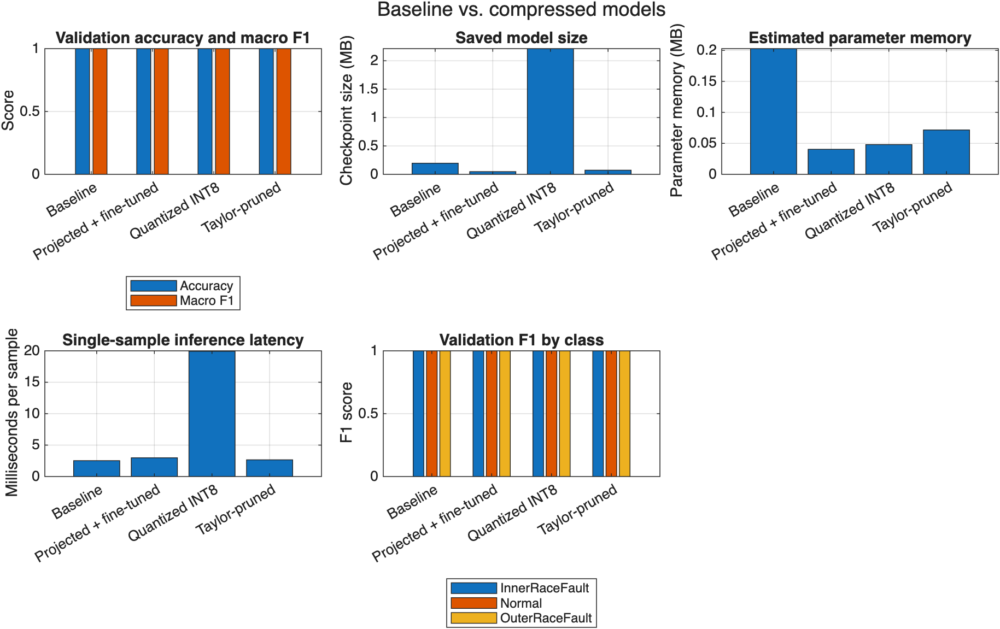

# Unlocking Embedded AI Through Efficient Compression

A 1-D convolutional neural network (CNN) that classifies rolling-element bearing
faults from vibration signals. We then compress it with pruning, projection, and
quantization so it fits on embedded hardware.

Break Through Tech AI Studio, Fall 2026. Host company: MathWorks.

## Team Members

| Name                          | GitHub Handle      | Contribution |
| ----------------------------- | ------------------ | ------------ |
| Bezawit Gessesse              | @bezqwit           |              |
| Chikaosolu Nnadozie           | @cnnadozi          |              |
| Anisha Bollapragada           | @AnishaRaoB        |              |
| Lena Ngo                      | @lenan14           |              |
| Huy Huynh                     | @baohuy1303        |              |
| **Sahana Balagali**           | @sbalagali         |              |
| **Tobechukwu Ikenwe Othniel** | @Tobechukwu-Ikenwe |              |

## Project Highlights

- Trained a 1-D CNN (50,707 parameters) that classifies bearing signals as
Normal, Inner Race Fault, or Outer Race Fault with 100% validation (27/27) and
test (102/102) accuracy.
- Compared three compression methods. Projection removed **80% of the
parameters** (0.20 MB → 0.04 MB in memory) with no accuracy loss.
- Taylor filter pruning removed 65% of the parameters, and INT8 quantization cut
parameter memory by about 76%. Both kept 100% validation accuracy.
- Generated C code from the projected model with MATLAB Coder. Its predictions
matched MATLAB's on all 102 test signals (largest score difference 6.1e-10).

## Repository Layout

| Path | Contents |
|------|----------|
| `data/` | Dataset splits, preprocessed data, and model checkpoints. See [data/README.md](data/README.md). |
| `data/models/` | One subfolder per method: `baseline/`, `pruned/`, `projected/`, `quantized/` |
| `notebooks/` | Milestone 1 Jupyter notebooks (Python) and Milestone 2 MATLAB scripts |
| `scripts/` | Evaluation, quantization, and code-generation scripts |
| `tasks/` | [TASKS.md](tasks/TASKS.md) (task index) and one write-up per task, grouped by milestone |
| `AGENTS.md` | File naming convention for notebooks and write-ups |

## Setup and Installation

### 1. Clone the repository

```bash
git clone https://github.com/Break-Through-Tech/MathWorks-1D-unlocking-embedded-ai-through-efficient-compression.git
cd MathWorks-1D-unlocking-embedded-ai-through-efficient-compression
```

The dataset and trained checkpoints are already in `data/`. You don't need to
download anything else.

### 2. Python (Milestone 1 notebooks and input quantization)

```bash
python -m venv .venv
source .venv/bin/activate          # Windows: .venv\Scripts\activate
pip install -r requirements.txt
jupyter notebook notebooks/
```

### 3. MATLAB (model training, compression, and code generation)

Use MATLAB Online or MATLAB Desktop. Run every script from the repository root.

| Requirement | Needed for |
|-------------|------------|
| MATLAB R2024b or newer | All MATLAB scripts (R2023b is enough for baseline training only) |
| Deep Learning Toolbox | All models |
| Deep Learning Toolbox Model Compression Library (support package) | Pruning, projection, quantization |
| Fixed-Point Designer | Quantization |
| MATLAB Coder | Embedded code generation |

### 4. Run order

Each step reads the outputs of the steps above it. The checkpoints are already
committed, so you can start from any step.

| Step | Command (MATLAB, from repo root) | Output |
|------|----------------------------------|--------|
| Train baseline | `addpath("data"); run("notebooks/M2_01_baseline_model.m")` | `data/models/baseline/baseline_net.mat` |
| Evaluate baseline | `addpath("scripts"); metrics = M2_02_evaluate_baseline();` | Metrics printed to console |
| Pruning | `run("notebooks/M2_03_pruning.m")` | `data/models/pruned/*.mat`, sweep plots |
| Projection | `run("notebooks/M2_04_projection.m")` | `data/models/projected/*.mat`, sweep plot |
| Quantization | `run("scripts/M2_02_quantize_model.m")` | `data/models/quantized/quantized_net.mat` |
| Compare all models | `run("notebooks/M2_06_compare_compression.m")` | `tasks/milestone_2/figures/M2_06_comparison.*` |
| Generate C code | `run("scripts/M3_01_generate_embedded_code.m")` | `codegen/` folder (not committed) |

To regenerate `data/quantized.mat` (INT8 *input signals*, not a model), run
`python scripts/quantize_data.py`.

## Project Overview

This project is part of the Break Through Tech AI Program's AI Studio, where
teams work on a real problem from a host company. Our host, MathWorks, asked us
to build a fault diagnosis model for smart appliances and make it small enough
to run on embedded hardware.

**Objective:** Train a deep learning model that identifies bearing faults from
vibration data. Then apply at least two compression techniques and document the
trade-offs between accuracy, size, and speed.

**Why it matters:** Bearings fail in motors, appliances, and industrial
machines. Detecting faults early prevents breakdowns and costly repairs. Running
the model on the device itself (instead of in the cloud) avoids network delays
and keeps data local. Embedded chips have very little memory and compute, so the
model has to be compressed first.

## Data Exploration

The dataset is the Rolling Element Bearing Fault Diagnosis dataset (Eric
Bechhoefer, CC BY-NC-SA 4.0). Each sample is a 5,000-point vibration window
sampled at 48,828 Hz. Full details are in [data/README.md](data/README.md).

| Split | Samples | Per class |
|-------|---------|-----------|
| Train | 393 | 131 |
| Validation | 27 | 9 |
| Test | 102 | 34 |

We inspected the data to confirm:

- the expected matrix shapes and label formats,
- the presence of all three classes: Normal, InnerRaceFault, OuterRaceFault,
- balanced class counts across the training split,
- no missing or invalid values.

We also reviewed unusually large and small signal values. We kept them because
they may reflect real faults rather than bad data.

Before training, every signal was standardized with the per-column mean and
standard deviation of the **training set only** (`data/scaler.mat`). Nothing is
fit on validation or test data.

## Model Development

**Baseline:** A 1-D CNN with three convolutional blocks (16, 32, and 64 filters),
batch normalization, max pooling, global average pooling, dropout (0.3), and a
fully connected softmax output. It has 50,707 learnable parameters.

| Setting | Value |
|---------|-------|
| Optimizer | Adam, learning rate 0.001 |
| Epochs / batch size | Up to 30 / 32 |
| Loss | Cross-entropy |
| Model selection | Best validation network kept |
| Training time | About 40 seconds on one CPU |

**Compression methods:**

| Method | What it does | Write-up |
|--------|--------------|----------|
| Magnitude pruning | Sets the smallest weights in each layer to zero | [M2_03_pruning.md](tasks/milestone_2/M2_03_pruning.md) |
| Taylor pruning | Removes whole conv filters that matter least to the loss, then fine-tunes | [M2_03_pruning.md](tasks/milestone_2/M2_03_pruning.md) |
| Projection | Replaces layers with smaller ones that keep the main directions of the activations (PCA), then fine-tunes | [M2_04_projection.md](tasks/milestone_2/M2_04_projection.md) |
| Quantization | Stores weights as 8-bit integers instead of 32-bit floats | [M2_05_quantization.md](tasks/milestone_2/M2_05_quantization.md) |

## Results and Key Findings

All models were compared on the validation split on the same machine
([M2_06_compare_compression.md](tasks/milestone_2/M2_06_compare_compression.md)).

| Model | Accuracy | Macro F1 | Parameters | Parameter memory | Inference |
|-------|----------|----------|------------|------------------|-----------|
| Baseline | 100% | 1.00 | 50,707 | 0.203 MB | 2.5 ms |
| Taylor-pruned | 100% | 1.00 | 17,895 (−65%) | 0.072 MB | 2.7 ms |
| Projected + fine-tuned | 100% | 1.00 | 10,106 (−80%) | 0.040 MB | 3.0 ms |
| Quantized INT8 | 100% | 1.00 | 50,707 (INT8) | 0.048 MB | 19.9 ms |



**Key findings:**

- **Projection gave the best trade-off.** It removed 80% of the parameters with
no retraining and no accuracy loss. At 90%, accuracy fell to 93%.
- **Taylor pruning shrinks the model; magnitude pruning doesn't.** Magnitude
pruning zeroed 60% of the weights with no accuracy loss, but the zeros are
still stored, so memory stayed the same.
- **Speed differences in MATLAB are mostly noise.** For one small sample, most of
the time is MATLAB's per-call overhead. Run-to-run variation is about 2 ms.
The INT8 model is slower here because MATLAB simulates integer math on a
desktop CPU. Real speed gains need generated code on the target device.
- **Checkpoint file size is not memory use.** The quantized `.mat` file is 2.2 MB
because of how MATLAB saves the object, even though its weights take 0.048 MB.
- **The task is easy for this dataset.** Every model scored 100%. The validation
set has only 27 samples, so each mistake costs about 3.7 accuracy points.

## Next Steps

- **Test on harder data.** All data comes from one test rig in a lab. Real
appliances have more noise and varied operating conditions.
- **Measure on real hardware.** We verified the generated C code in MATLAB
Online. We have not yet measured its speed or memory on an embedded board.
- **Combine methods.** For example, quantize the projected model to stack both
savings.
- **Evaluate all compressed models on the test split.** The comparison above
uses the 27-sample validation split.
- TODO: add the team's own reflections on limitations and what you'd do with
more time.

## License

TODO: choose a code license and get Challenge Advisor approval (for example,
MIT).

The dataset is licensed under
[CC BY-NC-SA 4.0](https://creativecommons.org/licenses/by-nc-sa/4.0/) by its
owner and cannot be used commercially.

## References

- Dataset: Eric Bechhoefer, Rolling Element Bearing Fault Diagnosis,
data-acoustics.com
- MathWorks, [Rolling Element Bearing Fault Diagnosis Using Deep Learning](https://www.mathworks.com/help/predmaint/ug/rolling-element-bearing-fault-diagnosis-using-deep-learning.html)
- MathWorks, [Compressing Neural Networks for Embedded AI: Pruning, Projection, and Quantization](https://www.youtube.com/watch?v=7uV3-eTB5es) (video)
- [A Practical Introduction to Edge AI](https://www.youtube.com/watch?v=ibm6ZRi6Sm4) (video)

## Acknowledgements

Thank you to our Challenge Advisor, Shanmukh Srinivas (MathWorks), our AI Studio
Coach, Rashidah Carr, and the Break Through Tech team. Thanks also to Eric
Bechhoefer for sharing the dataset.
