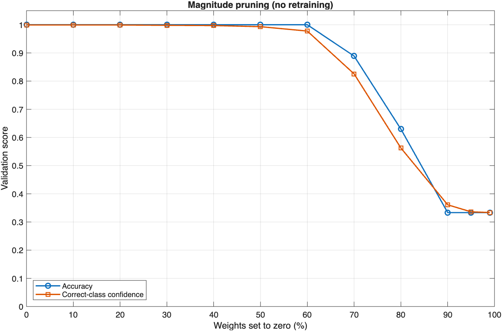
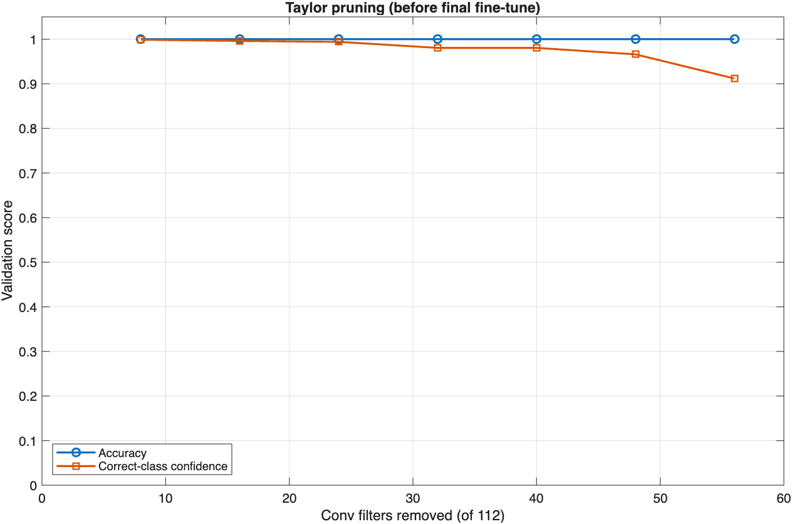

# M2 Task 3: Apply Pruning

**Owner:** Chikaosolu  
**Milestone:** October - Model Development & Compression

## Goal

Remove unnecessary weights from the trained baseline model and compare the new accuracy, size, and speed against the baseline results in M2_02_accuracy_function.md

## Approach

1. **Magnitude pruning**

- Load `baseline_net.mat`.
- Pick a sparsity, like 50%. Set the 50% smallest weights in the conv and FC layers to 0. Leave biases and batchnorm alone.
- Measure validation accuracy. Repeat for 10% through 90% and plot it.
- Magnitude pruning is applied **per layer** (each conv/FC layer loses the same fraction of its weights), so the small first conv layer and final FC layer are never wiped out by a single global threshold.

2. **Taylor (filter) pruning** (to actually shrink the model)

- Wrap the baseline in `taylorPrunableNetwork`.
- Each iteration: train for one pass over the training set while scoring every conv filter by how much the loss depends on it, then remove the 8 lowest-scoring filters. Run 7 iterations, removing 56 filters. The baseline has 112 conv filters, but the tool only treats 91 of them as removable.
- Fine-tune the pruned network for 20 epochs (Adam, learning rate 1e-3, same as the baseline's training).

## Files

| File | What it does |
|------|--------------|
| [`M2_03_pruning.m`](../../notebooks/M2_03_pruning.m) | Runs both phases and prints a comparison table against the baseline. Saves the pruned models to `data/pruned/` (`magnitude_pruned_net.mat`, `taylor_pruned_net.mat`) and the plots to `tasks/milestone_2/figures/`. |

## How to Run

From the repository root in MATLAB (or in the Cursor terminal):

```matlab
run("notebooks/M2_03_pruning.m")
```

## Metrics Reported

Everything from M2_02_accuracy_function.md, and also the folloiwng[f](http://function.md)

- **Correct-class confidence:** the average probability the model gives the true class.
- **Nonzero parameters:** how many weights are left after pruning.
- **In-memory size (MB):** parameters × 4 bytes. This is what the model needs on a device

## Magnitude Pruning Results

Produced by `M2_03_pruning.m` on the validation split (27 samples, 9 per class). 



60% is the highest sparsity that keeps baseline accuracy.

| Metric | Baseline | Magnitude 60% |
|--------|----------|---------------|
| Accuracy | 1.0000 (27 / 27) | 1.0000 (27 / 27) |
| Macro F1 | 1.0000 | 1.0000 |
| Correct-class confidence | 0.9993 | 0.9776 |
| Parameters | 50,707 | 50,707 |
| Nonzero parameters | 50,707 | 20,487 (40%) |
| In-memory size | 0.2028 MB | 0.2028 MB |
| Inference speed | ~4.4 ms/sample | ~4.8 ms/sample (4.68 and 5.00 ms in two runs) |

**Per-class metrics** (Magnitude 60%) - same as basline model

**Confusion matrix** (Magnitude 60%; rows = true class, columns = predicted class) - same as baseline model

**Takeaways**

- Without any retraining, the model tolerates losing 60% of its weights with no accuracy loss. 
- Confidence starts slipping at 50–60%, then accuracy falls off a cliff: 0.89 at 70%, 0.63 at 80%, and random guessing (0.33) from 90%.
- The inference speed is NOT SUPPOSED TO CHANGE. Computer still has to process the 0s like any other weights.

## Taylor Pruning Results

Produced by `M2_03_pruning.m` on the validation split (27 samples, 9 per class). 8 filters removed per iteration for 7 iterations



| Metric | Baseline | Taylor (56 filters removed) + fine-tune |
|--------|----------|---------------|
| Accuracy | 1.0000 (27 / 27) | 1.0000 (27 / 27) |
| Macro F1 | 1.0000 | 1.0000 |
| Correct-class confidence | 0.9993 | 0.9946 |
| Conv filters | 112 | 56 |
| Parameters | 50,707 | 17,895 (−65%) |
| In-memory size | 0.2028 MB | 0.0716 MB |
| Inference speed | 5.8–6.9 ms/sample | 5.0–5.7 ms/sample |

**Per-class metrics** (Taylor) - same as baseline model

**Confusion matrix** (Taylor; rows = true class, columns = predicted class) - same as baseline model

**Takeaways**

- Unlike magnitude pruning, Taylor pruning actually shrinks the model: 65% fewer parameters and 65% less memory, with the same accuracy and nearly the same confidence after fine-tuning.
- Confidence drops as filters are removed (0.91 after removing 56), and fine-tuning brings it back to 0.99.
- Pruning harder (10 iterations, 80 filters removed) made the model 88% smaller (5,895 parameters) and still 100% accurate, but confidence only recovered to 0.93 after fine-tuning. Some signals become close calls, so 7 iterations is the safer choice.
- The speed difference is within run-to-run noise. The model does about half the math, but for one small sample most of the time is MATLAB's fixed per-call overhead, not the math. On an embedded device with generated code, the smaller model should be noticeably faster.
