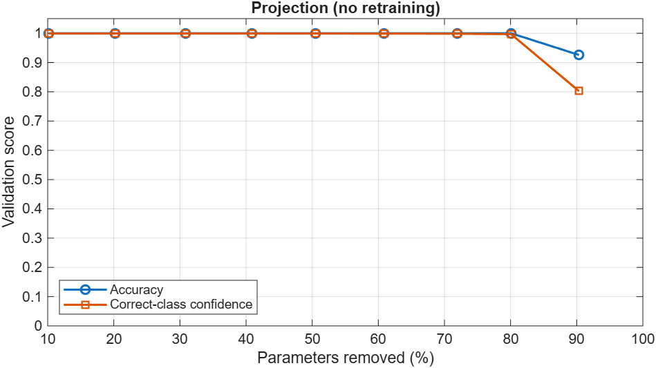

# M2 Task 4: Apply Projection

**Owner:** Huy  
**Milestone:** October - Model Development & Compression  
**Issue:** [#17](https://github.com/Break-Through-Tech/MathWorks-1D-unlocking-embedded-ai-through-efficient-compression/issues/17)

## Goal

Compress the trained baseline model with projection and compare the new accuracy, size, and speed against the baseline results in M2_02_accuracy_function.md

## Approach

1. **Neuron PCA**

- Load `baseline_net.mat`.
- Run `neuronPCA` on the training set. It records the principal components of the activations going into and out of every conv and FC layer. Validation and test data are not used here.

2. **Projection sweep**

- Run `compressNetworkUsingProjection` with a learnables reduction goal from 10% through 90%. Each layer's weights are replaced by smaller layers that only keep the directions carrying most of the activation variance.
- Measure validation accuracy with no retraining and plot it.

3. **Fine-tune**

- Pick the most aggressive goal that still matches baseline accuracy (80%).
- Fine-tune the projected network for 20 epochs (Adam, learning rate 1e-3, same as the baseline's training and the M2_03 Taylor pruning).
- Unpack the projected layers into ordinary conv/FC layers with `unpackProjectedLayers`, so the model works with code generation for embedded targets.

## Files

| File | What it does |
|------|--------------|
| [`M2_04_projection.m`](../../notebooks/M2_04_projection.m) | Runs the sweep and fine-tuning and prints a comparison table against the baseline. Saves the projected models to `data/projected/` (`projected_net.mat`, `projected_finetuned_net.mat`) and the plot to `tasks/milestone_2/figures/`. |

## How to Run

From the repository root in MATLAB (needs the Deep Learning Toolbox Model Compression Library support package):

```matlab
run("notebooks/M2_04_projection.m")
```

Takes about 40 seconds on MATLAB Online.

## Metrics Reported

Everything from M2_02_accuracy_function.md, and also the same extras as M2_03_pruning.md:

- **Correct-class confidence:** the average probability the model gives the true class.
- **In-memory size (MB):** parameters × 4 bytes. This is what the model needs on a device.

Speed uses the same timing as the baseline and pruning results: one sample per prediction, 200 untimed warm-up predictions, then the median of 100 runs.

## Projection Sweep Results

Produced by `M2_04_projection.m` on the validation split (27 samples, 9 per class). Run on 2026-11-03 with MATLAB R2026b on MATLAB Online.



| Reduction goal | Parameters | Parameters removed | Accuracy | Correct-class confidence |
|---|---:|---:|---:|---:|
| 10% | 45,544 | 10.2% | 1.0000 | 0.9993 |
| 20% | 40,479 | 20.2% | 1.0000 | 0.9992 |
| 30% | 35,045 | 30.9% | 1.0000 | 0.9993 |
| 40% | 29,995 | 40.8% | 1.0000 | 0.9992 |
| 50% | 25,121 | 50.5% | 1.0000 | 0.9990 |
| 60% | 19,861 | 60.8% | 1.0000 | 0.9989 |
| 70% | 14,231 | 71.9% | 1.0000 | 0.9985 |
| 80% | 10,106 | 80.1% | 1.0000 | 0.9970 |
| 90% | 4,898 | 90.3% | 0.9259 | 0.8023 |

80% is the highest goal that keeps baseline accuracy without any retraining.

## Final Results

| Metric | Baseline | Projected 80% | Projected 80% + fine-tune |
|--------|----------|---------------|---------------------------|
| Accuracy | 1.0000 (27 / 27) | 1.0000 (27 / 27) | 1.0000 (27 / 27) |
| Macro F1 | 1.0000 | 1.0000 | 1.0000 |
| Correct-class confidence | 0.9993 | 0.9970 | 0.9999 |
| Parameters | 50,707 | 10,106 (−80%) | 10,106 (−80%) |
| Checkpoint size | 0.1959 MB | 0.0513 MB | 0.0478 MB |
| In-memory size | 0.2028 MB | 0.0404 MB | 0.0404 MB |
| Inference speed | ~4.9 ms/sample | ~4.6 ms/sample | ~4.4 ms/sample |

**Per-class metrics** (both projected models) - same as baseline model

**Confusion matrix** (both projected models; rows = true class, columns = predicted class) - same as baseline model

**Where the parameters went**

| Layer | Baseline | After projection + unpacking |
|-------|----------|------------------------------|
| conv1 (1 → 16 channels) | not changed | not changed |
| conv2 (16 → 32 channels) | one 32-wide conv | 1x1 conv (16 → 14), 32-wide conv (14 → 15), 1x1 conv (15 → 32) |
| conv3 (32 → 64 channels) | one 16-wide conv | 16-wide conv (32 → 2), 1x1 conv (2 → 64) |
| FC (64 → 3) | one FC layer | FC (64 → 2), FC (2 → 3) |

## Takeaways

- Projection removed 80% of the parameters with no retraining and no accuracy loss. Taylor pruning removed 65% and needed fine-tuning to get there.
- Almost all of the savings came from conv2 and conv3, which hold most of the baseline's weights. conv3 was squeezed through just 2 channels, which shows most of its 64 output channels were redundant.
- Fine-tuning brought confidence back from 0.9970 to 0.9999, slightly above the baseline.
- Pushing to 90% made the model 90% smaller but dropped accuracy to 0.93 (2 mistakes) and confidence to 0.80 before fine-tuning, so 80% is the safer choice.
- The speed difference is within run-to-run noise. Same as pruning, most of the time for one small sample is MATLAB's fixed per-call overhead, not the math. On an embedded device with generated code, the smaller model should be noticeably faster.
